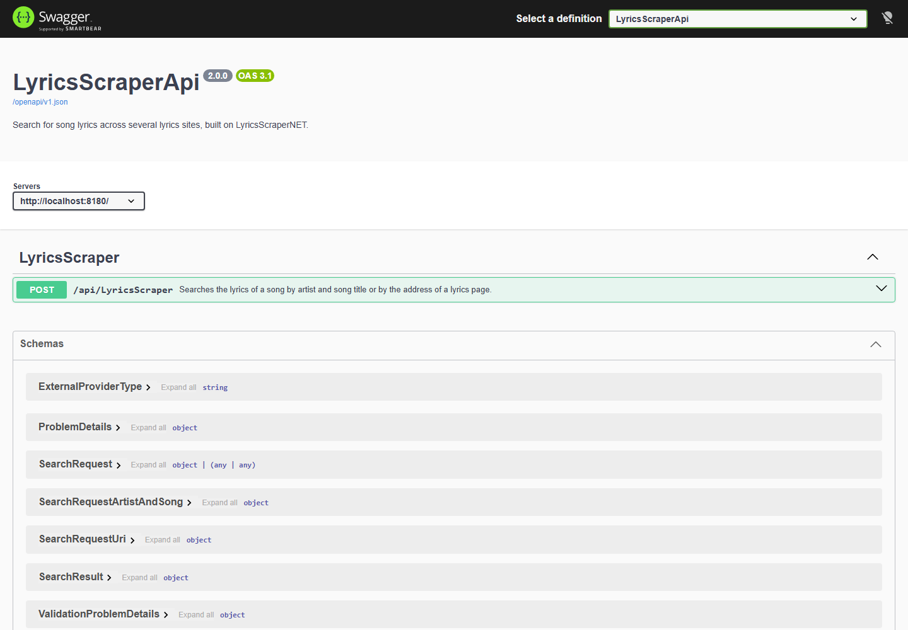

<h1 align="center">LyricsScraperApi</h1>
<p align="center">
  <a href="https://github.com/skuill/LyricsScraperApi/actions/workflows/cicd.yml"></a>
  <a href="https://www.codefactor.io/repository/github/skuill/lyricsscraperapi"></a>
  <a href="https://codecov.io/gh/skuill/LyricsScraperApi"></a>
  <a href="https://hub.docker.com/r/skuill/lyrics-scraper-api">
    
  </a>
  <a href="https://hub.docker.com/r/skuill/lyrics-scraper-api">
    
  </a>
</p>
<p align="center">
A .NET-based Web API that allows users to search for lyrics of a song from multiple external providers (like LRCLIB, AZLyrics, Genius, SongLyrics, etc.). It supports both artist/song and direct URL-based search requests.
</p>


## Quick start

Run the Docker image ([Docker Hub](https://hub.docker.com/r/skuill/lyrics-scraper-api), `linux/amd64` and `linux/arm64`):

```bash
docker run -d -p 8180:8180 --name lyrics-scraper-api skuill/lyrics-scraper-api:2
```

Search lyrics:

```bash
curl -X POST http://localhost:8180/api/LyricsScraper \
  -H "Content-Type: application/json" \
  -d '{"requestType":"ArtistAndSong","artist":"Parkway Drive","song":"Idols And Anchors"}'
```

Try the API in Swagger UI: http://localhost:8180/swagger.

## Documentation

| Topic | What is inside |
|---|---|
| [API reference](docs/api.md) | Search request, providers, responses and errors. |
| [Docker](docs/docker.md) | Run, image tags, settings, health check, local build. |
| [Development](docs/development.md) | Build, tests, code style, CI and release. |
| [Migrating from 1.x to 2.0](docs/migration-1.x-to-2.0.md) | What changed for clients in 2.0. |

Request examples: [`src/LyricsScraper.http`](src/LyricsScraper.http) and the [Postman collection](postman).

## Built with
* [LyricsScraperNET](https://github.com/skuill/LyricsScraperNET) - 🎼 A versatile .NET library that provides an API for searching song lyrics from the web.
* [ASP.NET Core 10](https://learn.microsoft.com/aspnet/core) with the built-in [OpenAPI document](https://learn.microsoft.com/aspnet/core/fundamentals/openapi/overview) and [Swagger UI](https://github.com/domaindrivendev/Swashbuckle.AspNetCore).
* [Serilog](https://serilog.net/) - Simple .NET logging with fully-structured events.
* [FluentValidation](https://fluentvalidation.net/) - A validation library for .NET that uses a fluent interface to construct strongly-typed validation rules.
* Tests: [xUnit v3](https://xunit.net/), [FakeItEasy](https://fakeiteasy.github.io/), [Shouldly](https://github.com/shouldly/shouldly).

## Responsible use

The service searches lyrics through LyricsScraperNET and does not store them. Lyrics are protected by the copyright of their authors and publishers: you are responsible for following the terms of use of each site and the copyright law that applies to you, especially if you show lyrics publicly. Details: [Responsible Use of LyricsScraperNET](https://github.com/skuill/LyricsScraperNET#️-responsible-use).

## Feedback

Feel free to send me feedback on [Telegram](https://t.me/skuill) or [file an issue](https://github.com/skuill/LyricsScraperApi/issues). Feature requests are always welcome. Roadmap: [issue board](https://github.com/skuill/LyricsScraperApi/issues).

## Support
If you want to support this project or my work in general, you can donate via the links below.

This is always optional! Thank you! 😉

 * [](https://www.buymeacoffee.com/skuill)
 * [](https://paypal.me/VitalyKvashin)
 * Crypto. Send only on the networks listed, a coin sent on another network may be lost:

| Network | Coins | Address |
|---|---|---|
| Bitcoin | BTC | `bc1q02d7p4qhjhjn5mnu99wdfc2j06d364jt8qeq0c` |
| Ethereum, Base, Arbitrum, Polygon, BNB Chain | ETH, USDT, USDC | `0xa56541B7DF6263ab84c3e1B69bD37f2a6d848412` |
| Solana | SOL, USDT, USDC | `BZcuV721p9XPsdreiKY9rsmxZDVf8qHNRk3EoPp25nrS` |
| Tron | USDT (TRC-20) | `TGyoTufYzVPU6igcQmFGwH1SFrNes9q3UP` |

## License

[MIT](LICENSE)
